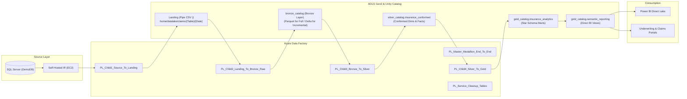
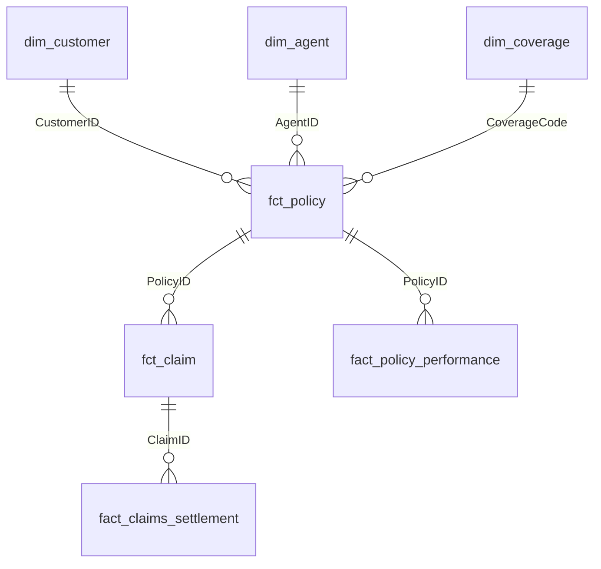

# Metadata-Driven Medallion Data Platform on Microsoft Azure & Databricks

[](https://azure.microsoft.com/en-us/products/data-factory)
[](https://www.databricks.com/)
[](https://delta.io/)
[](https://powerbi.microsoft.com/)
[](https://github.com/debaguddu/home-azure-project/actions/workflows/adf_auto_publish.yml)

A modern, metadata-driven enterprise data platform that automates multi-table ingestion from an On-Premises / Hybrid SQL Server (`DemoDB`) into Azure Data Lake Storage Gen2 (`azureprojectdevadls01`), processes data across a governed **Medallion Architecture** (Landing $\rightarrow$ Bronze $\rightarrow$ Silver $\rightarrow$ Gold), and deploys business semantic views for C-level dashboards and operational analytics.

---

## 📑 Table of Contents
1. [Architecture Overview](#-architecture-overview)
2. [Medallion Layers & Data Journey](#-medallion-layers--data-journey)
3. [Repository Structure](#-repository-structure)
4. [Azure Data Factory Pipelines](#-azure-data-factory-pipelines)
5. [Azure Databricks Notebooks & Workflows](#-azure-databricks-notebooks--workflows)
6. [SQL Control Plane & Metadata Tables](#-sql-control-plane--metadata-tables)
7. [Semantic Views & Analytics](#-semantic-views--analytics)
8. [Design Documentation & Presentations](#-design-documentation--presentations)
9. [Deployment & Verification Guide](#-deployment--verification-guide)

---

## 🏛 Architecture Overview



---

## 🏅 Medallion Layers & Data Journey

| Layer | Catalog / Storage Path | Format | Processing Logic & Value |
|---|---|---|---|
| **Landing** | `adls://landing/home/datalake/claims/{Table}/{YYYY}/{MM}/{DD}/` | Pipe CSV (`\|`) | Raw, timestamped extraction batches isolated by filename with pipe delimiter |
| **Bronze** | `bronze_catalog.raw_data` (`adls://bronze`) | Parquet / Delta | **Full Loads:** Snappy Parquet files; **Incremental Loads:** Delta MERGE with Schema Evolution, audit columns (`InsertedTimestamp`, `UpdatedTimestamp`, `RecordAction`), per-file DQ duplicate check |
| **Silver** | `silver_catalog.insurance_conformed` | Delta Lake | Cleaned, typed, conformed dimensions (`dim_customer`, `dim_agent`, `dim_coverage`) and fact tables (`fct_policy`, `fct_claim`) with SCD Type 1 upsert |
| **Gold** | `gold_catalog.insurance_analytics` | Delta Lake | Star schema analytical marts (`fact_policy_performance`, `fact_claims_settlement`) and monthly rollups (`agg_agent_performance_monthly`, `agg_claims_loss_ratio_by_coverage`, `agg_customer_risk_profile`) |
| **Semantic** | `gold_catalog.semantic_reporting` | UC Views | Direct-consume reporting views for Power BI, C-level executive KPIs, and claims adjudicators |

---

## 📂 Repository Structure

```text
├── databricks/
│   ├── notebooks/
│   │   ├── nb_incremental_landing_to_raw.ipynb  # Bronze raw Delta ingestion & DQ
│   │   ├── nb_transform_bronze_to_silver.ipynb  # Silver conformed dimensions & facts
│   │   ├── nb_transform_silver_to_gold.ipynb    # Gold star schema & aggregate marts
│   │   ├── nb_create_semantic_views.ipynb       # Deploys semantic reporting views
│   │   └── nb_service_cleanup_tables.ipynb      # Service utility for table & storage cleanup
│   └── workflows/
│       ├── job_incremental_landing_to_raw.json / .yml # Ingestion workflow definition
│       ├── job_bronze_to_silver.json / .yml          # Silver transformation workflow
│       ├── job_silver_to_gold.json / .yml            # Gold analytics workflow
│       ├── job_medallion_end_to_end.json / .yml      # Master Medallion multi-task DAG
│       └── job_service_cleanup_tables.json / .yml    # Cleanup utility workflow
├── dataset/
│   ├── DS_ADLS_Landing_CSV.json                 # Parameterized Landing ADLS pipe-delimited (|) CSV dataset
│   ├── DS_ADLS_Bronze_Parquet.json              # Parameterized Bronze ADLS Snappy Parquet dataset (Full loads)
│   ├── DS_ASQL_Generic.json                     # Generic Azure SQL Database dataset
│   └── DS_SQL_Source.json                       # On-Premises SQL Server dataset
├── docs/
│   ├── HLD_Medallion_Architecture.md            # High-Level Design document
│   ├── LLD_Pipeline_Specifications.md           # Low-Level Design specifications
│   ├── architecture_and_lineage.html            # Interactive HTML architecture & lineage
│   ├── executive_presentation.html              # HTML5 slide presentation deck
│   └── presentation_deck.md                     # Markdown slide presentation deck
├── linkedService/
│   ├── LS_ADLS_HOME_01.json                     # ADLS Gen2 Linked Service (MSI)
│   ├── LS_ADB_HOME_01.json                      # Azure Databricks Linked Service (MSI)
│   ├── LS_ASQL_HOME_01.json                     # Azure SQL Database Linked Service (Key Vault)
│   ├── LS_SQL_SERVER_01.json                    # On-Premises SQL Server Linked Service (SHIR)
│   └── LS_KV_HOME_01.json                       # Azure Key Vault Linked Service
├── pipeline/
│   ├── PL_Master_Medallion_End_To_End.json      # Master End-to-End Medallion Orchestrator
│   ├── PL_Master_Metadata_Ingestion.json        # Ingestion Orchestrator across active tables
│   ├── PL_Child1_Source_To_Landing.json         # Source extraction to Landing CSV
│   ├── PL_Child2_Landing_To_Bronze_Raw.json     # Landed pipe CSV processing to Bronze Parquet (Full) or Delta (Incremental)
│   ├── PL_Child3_Bronze_To_Silver.json          # Bronze to Silver conformed transformation
│   ├── PL_Child4_Silver_To_Gold.json            # Silver to Gold analytics & semantic deployment
│   └── PL_Service_Cleanup_Tables.json           # 1-click table drop and storage path cleanup
├── sql/
│   ├── 01_create_metadata_and_log_tables.sql    # DDL for IngestionMetadata, Watermark, ExecutionLog
│   ├── 02_seed_metadata.sql                     # Seed data for tables, watermarks, transformations
│   ├── 03_select_queries.sql                    # Quick queries to inspect metadata and execution logs
│   ├── 04_reset_watermarks.sql                  # Utility script to reset high-watermark timestamps
│   ├── 05_reset_inprogress_logs.sql             # Utility script to reset stuck InProgress execution logs
│   └── 06_create_semantic_views.sql             # DDL for Unity Catalog semantic reporting views
├── trigger/
│   ├── TR_Medallion_Daily_Full_Load.json        # Schedule trigger for Daily Full Load at 16:30 IST
│   └── TR_Medallion_Daily_Incremental_Load.json # Schedule trigger for Daily Incremental Load at 16:45 IST
└── DEPLOYMENT_GUIDE.md                          # Step-by-step infrastructure deployment manual
```

---

## ⚡ Azure Data Factory Pipelines

| Pipeline | Type | Responsibilities |
|---|---|---|
| [PL_Master_Medallion_End_To_End](file:///c:/Debaranjan/Git_Projects/home-azure-project/pipeline/PL_Master_Medallion_End_To_End.json) | Master | Orchestrates complete lifecycle: Ingestion Master $\rightarrow$ Silver $\rightarrow$ Gold $\rightarrow$ Semantic |
| [PL_Master_Metadata_Ingestion](file:///c:/Debaranjan/Git_Projects/home-azure-project/pipeline/PL_Master_Metadata_Ingestion.json) | Orchestrator | Iterates active tables in parallel, coordinating Child 1 and Child 2 |
| [PL_Child1_Source_To_Landing](file:///c:/Debaranjan/Git_Projects/home-azure-project/pipeline/PL_Child1_Source_To_Landing.json) | Worker | Queries SQL Server using dynamic watermark, generates unique filename, writes CSV, and returns `LandedFileName` via `pipelineReturnValue` |
| [PL_Child2_Landing_To_Bronze_Raw](file:///c:/Debaranjan/Git_Projects/home-azure-project/pipeline/PL_Child2_Landing_To_Bronze_Raw.json) | Worker | Ingests landed pipe-delimited CSVs into Bronze Parquet (Full) or Delta tables with schema evolution & watermark updates (Incremental) |
| [PL_Child3_Bronze_To_Silver](file:///c:/Debaranjan/Git_Projects/home-azure-project/pipeline/PL_Child3_Bronze_To_Silver.json) | Worker | Invokes `nb_transform_bronze_to_silver` to build conformed dimensions & facts |
| [PL_Child4_Silver_To_Gold](file:///c:/Debaranjan/Git_Projects/home-azure-project/pipeline/PL_Child4_Silver_To_Gold.json) | Worker | Invokes `nb_transform_silver_to_gold` to build star schema marts and deploys reporting views |
| [PL_Service_Cleanup_Tables](file:///c:/Debaranjan/Git_Projects/home-azure-project/pipeline/PL_Service_Cleanup_Tables.json) | Maintenance | Triggers Databricks Job activity (free-tier friendly, no cluster creation permissions needed) to drop Unity Catalog tables, delete ADLS storage paths, and reset watermarks |

---

## ⏰ Scheduled Triggers

| Trigger | Target Pipeline | Schedule (IST) | Load Type | Parameters Passed |
|---|---|---|---|---|
| [TR_Medallion_Daily_Full_Load](file:///c:/Debaranjan/Git_Projects/home-azure-project/trigger/TR_Medallion_Daily_Full_Load.json) | `PL_Master_Medallion_End_To_End` | Daily at **16:30 IST** | `Full` | `TriggerName`: `Daily_Trigger`, `LoadType`: `Full` |
| [TR_Medallion_Daily_Incremental_Load](file:///c:/Debaranjan/Git_Projects/home-azure-project/trigger/TR_Medallion_Daily_Incremental_Load.json) | `PL_Master_Medallion_End_To_End` | Daily at **16:45 IST** | `Incremental` | `TriggerName`: `Daily_Trigger`, `LoadType`: `Incremental` |

---

## 📊 Core Join Logics & Business Value



1. **Policy Performance Mart (`fact_policy_performance`):**
   - Joins `fct_policy` with `dim_customer`, `dim_agent`, `dim_coverage`, and aggregated `fct_claim`.
   - **Formulas:**
     - $\text{Net Profit Margin} = \text{PremiumAmount} - \text{TotalClaimsIncurred}$
     - $\text{Loss Ratio \%} = \left(\frac{\text{TotalClaimsIncurred}}{\text{PremiumAmount}}\right) \times 100$
   - **Value:** Enables underwriters to immediately identify unprofitable policyholders and under-performing agency branches.

2. **Claims Settlement Mart (`fact_claims_settlement`):**
   - Joins `fct_claim` with `fct_policy` and `dim_customer`.
   - **Formulas:**
     - $\text{Settlement Ratio \%} = \left(\frac{\text{SettledAmount}}{\text{ClaimAmount}}\right) \times 100$
     - $\text{Settlement Turnaround} = \text{DATEDIFF}(\text{ClaimDate}, \text{IncidentDate})$
   - **Value:** Automatically classifies severity tiers ($\ge \$50\text{K}$ High, $\ge \$10\text{K}$ Medium) and flags deductible compliance.

---

## 💎 Semantic Views Catalog

| View Name | Schema | Key Metric | Target Audience |
|---|---|---|---|
| `vw_executive_kpi_dashboard` | `gold_catalog.semantic_reporting` | Gross Written Premium, Loss Ratio %, Active Policy Count | C-Level Leadership |
| `vw_claims_analyst_workbench` | `gold_catalog.semantic_reporting` | Payout Ratio %, Deductible Assessment, SLA Alerts | Claims Adjusters |
| `vw_agent_leaderboard` | `gold_catalog.semantic_reporting` | Premium Rankings, Producer Tiers (Platinum/Gold/Silver) | Sales Leadership |
| `vw_customer_360` | `gold_catalog.semantic_reporting` | Lifetime Premium, Total Claims, Risk Tier (Prime/High Risk) | Underwriting & CRM |

---

## 📖 Design Documentation & Presentations

Explore the comprehensive design documentation in the [`docs/`](file:///c:/Debaranjan/Git_Projects/home-azure-project/docs/) directory:
- [HLD_Medallion_Architecture.md](file:///c:/Debaranjan/Git_Projects/home-azure-project/docs/HLD_Medallion_Architecture.md): Complete High-Level Design, architecture principles, and security framework.
- [LLD_Pipeline_Specifications.md](file:///c:/Debaranjan/Git_Projects/home-azure-project/docs/LLD_Pipeline_Specifications.md): Low-Level Design, field-level data dictionary, and join logic.
- [architecture_and_lineage.html](file:///c:/Debaranjan/Git_Projects/home-azure-project/docs/architecture_and_lineage.html): Standalone interactive HTML dashboard featuring live Mermaid diagrams and metadata matrices.
- [executive_presentation.html](file:///c:/Debaranjan/Git_Projects/home-azure-project/docs/executive_presentation.html): Interactive HTML5 slide presentation deck with slide controls and executive visuals.
- [presentation_deck.md](file:///c:/Debaranjan/Git_Projects/home-azure-project/docs/presentation_deck.md): Markdown presentation slide deck.

---

## 🚀 Deployment & Verification Guide

For detailed step-by-step setup, see the complete [DEPLOYMENT_GUIDE.md](file:///c:/Debaranjan/Git_Projects/home-azure-project/DEPLOYMENT_GUIDE.md).

### Quickstart Workflow:

1. **Deploy Control Plane Objects (Azure SQL Database):**
   - Execute [01_create_metadata_and_log_tables.sql](file:///c:/Debaranjan/Git_Projects/home-azure-project/sql/01_create_metadata_and_log_tables.sql) to create schemas, watermark tables, and logging procedures.
   - Execute [02_seed_metadata.sql](file:///c:/Debaranjan/Git_Projects/home-azure-project/sql/02_seed_metadata.sql) to seed the 5 source tables, initial watermarks, and Silver/Gold metadata.

2. **Configure Azure Databricks (Unity Catalog & Git):**
   - Execute [01_unity_catalog_setup.sql](file:///c:/Debaranjan/Git_Projects/home-azure-project/databricks/sql/01_unity_catalog_setup.sql) in Databricks SQL Editor to configure catalogs (`landing_catalog`, `bronze_catalog`, `silver_catalog`, `gold_catalog`), external locations, and volumes.
   - Link repository in Databricks **Workspace** $\rightarrow$ **Repos** on branch `develop`.

3. **Configure CI/CD Automation (GitHub Actions):**
   - In GitHub repository **Settings** $\rightarrow$ **Secrets and variables** $\rightarrow$ **Actions**, configure:
     - `AZURE_SUBSCRIPTION_ID`: Azure Subscription GUID
     - `AZURE_RESOURCE_GROUP`: Target Resource Group (`rg-azureproject-dev-01`)
     - `DATABRICKS_TOKEN`: Databricks Personal Access Token (PAT)
     - `DATABRICKS_REPO_ID`: Numeric Databricks Git folder ID (e.g. `2906326734200206`)
   - Any push to `develop` automatically compiles ARM templates to `adf_publish` and triggers git pull in Databricks!

4. **Execute Master Pipeline (Azure Data Factory):**
   - Trigger [PL_Master_Medallion_End_To_End](file:///c:/Debaranjan/Git_Projects/home-azure-project/pipeline/PL_Master_Medallion_End_To_End.json) in ADF Studio with `LoadType = Full` or `Incremental`.
   - The master pipeline orchestrates ingestion from SQL Server into Landing, processes Bronze Delta, conforms Silver dimensions & facts, aggregates Gold analytical marts, and deploys Semantic Views.

5. **Environment Reset (When Needed):**
   - Run [PL_Service_Cleanup_Tables](file:///c:/Debaranjan/Git_Projects/home-azure-project/pipeline/PL_Service_Cleanup_Tables.json) in ADF with `TableName = ALL` to wipe test data, drop tables, and reset watermarks in 1-click.
