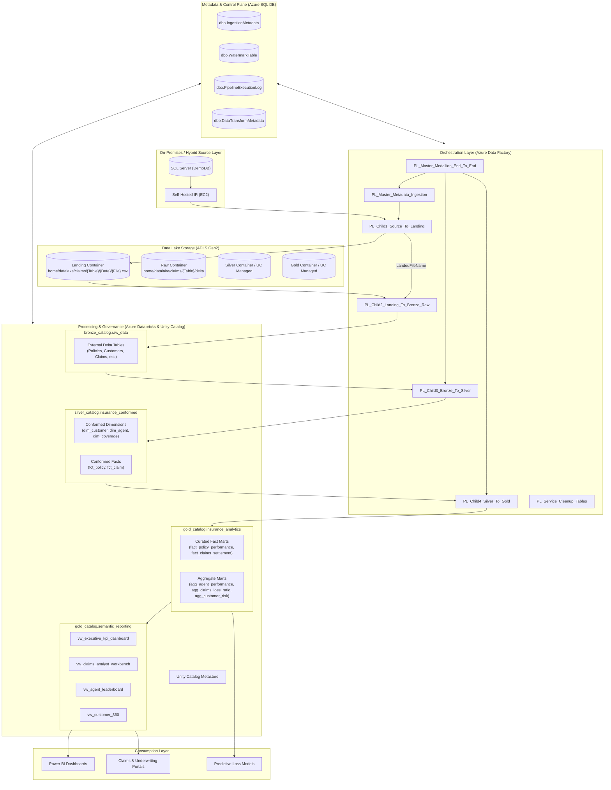

# High-Level Design (HLD): End-to-End Metadata-Driven Medallion Data Platform

## 1. Executive Summary
The **Metadata-Driven Medallion Data Platform** is an enterprise data engineering solution deployed on Microsoft Azure and Databricks. The platform automates data ingestion from on-premises/hybrid SQL Server databases (`DemoDB`), processes it through a governed multi-hop **Medallion Architecture** (Bronze $\rightarrow$ Silver $\rightarrow$ Gold), and serves curated analytical models and semantic views to executive dashboards, operational workbenches, and BI consumers.

---

## 2. Business Objectives & Key Results (OKRs)
- **Zero-Touch Extensibility**: Onboarding new tables or modifying load parameters requires **only a metadata insert** in Azure SQL Database without modifying or redeploying ADF pipelines.
- **Data Freshness & Idempotency**: Dynamic watermark tracking ensures low-latency incremental extracts without duplicate processing across intraday runs.
- **Enterprise Governance**: Centralized Unity Catalog controls access, data lineage, and audit trails across all storage tiers.
- **Accelerated Analytics**: Standardized business metrics (e.g., Loss Ratio %, Claims Settlement Turnaround, Net Profit Margin) are pre-aggregated in Gold analytical marts for sub-second BI query response times.

---

## 3. High-Level System Architecture

---

## 4. Medallion Layer Definitions

| Layer | Catalog / Storage Path | Data State | Format | Primary Objective |
|---|---|---|---|---|
| **Landing** | `abfss://landing@.../home/datalake/claims/{Table}/{YYYY}/{MM}/{DD}/` | Raw Extracts | CSV (Timestamped) | Lossless raw snapshot per extraction batch |
| **Bronze (Raw)** | `bronze_catalog.raw_data` (`abfss://raw@.../claims/{Table}/delta`) | As-Is Ingested | Delta Lake (Append / UPSERT) | Schema evolution, technical audit columns, duplicate checks per file |
| **Silver** | `silver_catalog.insurance_conformed` | Cleaned, Standardized | Delta Lake (SCD Type 1) | Data hygiene, type casting, conformed dimensions, enriched facts |
| **Gold** | `gold_catalog.insurance_analytics` | Curated Business Marts | Delta Lake (Star Schema) | High-performance aggregations, loss ratio KPIs, customer risk scores |
| **Semantic** | `gold_catalog.semantic_reporting` | Business Reporting Views | Unity Catalog Views | Direct BI consume, Power BI Direct Lake / SQL Warehouse |

---

## 5. Technology Stack & Component Rationale

| Component | Service | Role in Architecture | Key Advantage |
|---|---|---|---|
| **Orchestration** | Azure Data Factory | Workflow execution & scheduling | Native SHIR integration, parameter passing, enterprise triggers |
| **Control Plane** | Azure SQL Database | Metadata, Watermarks, Execution Logs | ACID transactions, stored procedures, flexible schema querying |
| **Compute Engine** | Azure Databricks (Serverless / D4s_v5) | ETL, Delta Merge, Aggregations | Fast execution, auto-scaling, Spark Connect, ACID Delta Lake |
| **Governance** | Databricks Unity Catalog | Access control & Metastore | Single governance model, line of business isolation via 3-level naming |
| **Data Lake** | Azure ADLS Gen2 | Storage tier (Landing, Raw, Bronze) | Hierarchical namespace, cost-effective tiering, POSIX ACLs |
| **Security** | Managed Identity (MSI) & Azure Key Vault | Authentication & Secret management | Zero hardcoded credentials across pipelines, clusters, and databases |

---

## 6. Security, Identity & Governance Framework
1. **Managed Identity (MSI)**: ADF authenticates to Azure Databricks via Managed Identity (`resource: 2ff814a6-3304-4ab8-85cb-cd0e6f879c1d`), eliminating token expiration issues.
2. **Unity Catalog Three-Level Namespace**:
   - Syntax: `<catalog>.<schema>.<table_or_view>`
   - Catalogs isolate environments and data maturity tiers (`landing_catalog`, `bronze_catalog`, `silver_catalog`, `gold_catalog`).
3. **Data Protection**:
   - In-Transit: TLS 1.2+ mandatory across all connections.
   - At-Rest: Azure Storage Service Encryption (SSE) with platform/customer-managed keys.

---

## 7. Operational Resilience & Fault Tolerance
- **Idempotent Ingestion**: Timestamped file generation paired with ADF-to-Databricks `file_name` widget parameters prevents cross-batch duplicate reading.
- **Automated Service Cleanup**: Dedicated pipeline (`PL_Service_Cleanup_Tables`) and notebook (`nb_service_cleanup_tables`) enable 1-click environment resets.
- **Comprehensive Audit Log**: `dbo.PipelineExecutionLog` tracks execution runtimes, rows copied, and error messages at both batch and table levels.
