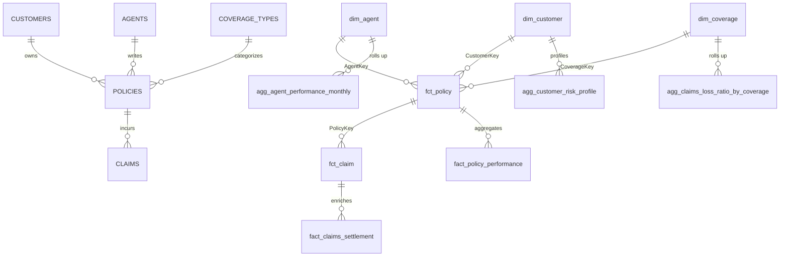
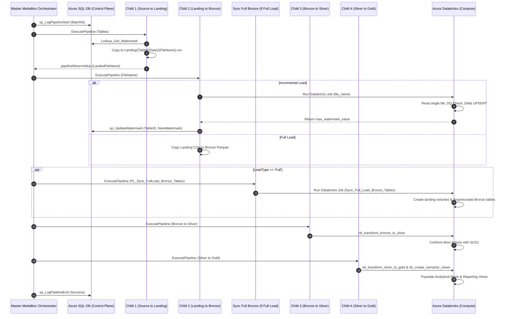

# Low-Level Design (LLD): Pipeline Specifications & Data Dictionary

## 1. Metadata Schema Specifications

### 1.1 `dbo.IngestionMetadata`
Defines source-to-landing-to-bronze ingestion parameters.
```sql
CREATE TABLE dbo.IngestionMetadata (
    TableID                 INT IDENTITY(1,1) PRIMARY KEY,
    TriggerName             VARCHAR(50)  NOT NULL, -- 'Daily_Trigger'
    SourceSchema            VARCHAR(50)  NOT NULL DEFAULT 'dbo',
    SourceTableName         VARCHAR(100) NOT NULL,
    LoadType                VARCHAR(20)  NOT NULL, -- 'Incremental' or 'Full'
    WatermarkColumn         VARCHAR(100) NULL,     -- e.g. 'ModifiedDate'
    TargetContainerLanding  VARCHAR(100) NOT NULL DEFAULT 'landing',
    TargetContainerBronze   VARCHAR(100) NOT NULL DEFAULT 'bronze',
    IsActive                CHAR(1)      NOT NULL DEFAULT 'Y',
    SendAlert               CHAR(1)      NOT NULL DEFAULT 'Y',
    PrimaryKeys             VARCHAR(255) NULL,     -- Comma-separated (e.g. 'PolicyID')
    MandatoryColumns        VARCHAR(255) NULL      -- Comma-separated (e.g. 'PolicyID,CustomerID')
);
```

### 1.2 `dbo.WatermarkTable`
Tracks high-watermark timestamps for incremental delta extracts.
```sql
CREATE TABLE dbo.WatermarkTable (
    WatermarkID             INT IDENTITY(1,1) PRIMARY KEY,
    TableID                 INT NOT NULL FOREIGN KEY REFERENCES dbo.IngestionMetadata(TableID),
    SourceTableName         VARCHAR(100) NOT NULL,
    WatermarkColumn         VARCHAR(100) NOT NULL,
    WatermarkValue          VARCHAR(100) NOT NULL DEFAULT '1900-01-01 00:00:00',
    LastUpdatedDate         DATETIME2    NOT NULL DEFAULT SYSUTCDATETIME()
);
```

### 1.3 `dbo.DataTransformMetadata`
Orchestrates multi-hop dependencies across Silver and Gold layers.
```sql
CREATE TABLE dbo.DataTransformMetadata (
    TransformID             INT IDENTITY(1,1) PRIMARY KEY,
    Layer                   VARCHAR(20)  NOT NULL, -- 'Silver', 'Gold', 'Semantic'
    TargetCatalog           VARCHAR(50)  NOT NULL, -- 'silver_catalog', 'gold_catalog'
    TargetSchema            VARCHAR(50)  NOT NULL, -- 'insurance_conformed', 'insurance_analytics'
    TargetTableName         VARCHAR(100) NOT NULL,
    SourceTables            VARCHAR(255) NOT NULL, -- Dependency tables
    TransformationType      VARCHAR(50)  NOT NULL, -- 'Dimension_SCD1', 'Fact_Incremental', 'Curated_Fact'
    ExecutionOrder          INT          NOT NULL DEFAULT 1,
    IsActive                CHAR(1)      NOT NULL DEFAULT 'Y',
    Description             NVARCHAR(500) NULL
);
```

---

## 2. Entity-Relationship & Medallion Data Model



---

## 3. Data Flow & Transformations Per Layer

### 3.1 Silver Layer Specifications (`silver_catalog.insurance_conformed`)

#### `dim_customer` (Dimension - SCD Type 1)
- **Source**: `bronze_catalog.raw_data.Customers`
- **Primary Key**: `CustomerID`
- **Transformation Logic**:
  - `FirstName`, `LastName`: Trimmed and title-cased via `initcap(trim(...))`
  - `FullName`: Calculated as `concat_ws(' ', FirstName, LastName)`
  - `Email`: Normalized to lowercase and trimmed
  - `Phone`: Trimmed formatting
  - **Deduplication**: Window partitioned by `CustomerID` ordered by `_ingested_at DESC`, keeping rank 1.
  - **Merge**: `MERGE INTO dim_customer target USING src ON target.CustomerID = src.CustomerID WHEN MATCHED THEN UPDATE SET * WHEN NOT MATCHED THEN INSERT *`

#### `dim_agent` (Dimension - SCD Type 1)
- **Source**: `bronze_catalog.raw_data.Agents`
- **Primary Key**: `AgentID`
- **Transformation Logic**:
  - `FirstName`, `LastName`: Trimmed and title-cased
  - `FullName`: Calculated as `concat_ws(' ', FirstName, LastName)`
  - `Region`, `BranchName`: Standardized and trimmed
  - **Merge**: SCD Type 1 Upsert on `AgentID`.

#### `dim_coverage` (Dimension - Reference)
- **Source**: `bronze_catalog.raw_data.CoverageTypes`
- **Primary Key**: `CoverageCode`
- **Transformation Logic**:
  - `CoverageCode`: Trimmed and capitalized
  - `Category`: Grouped into standard lines of business (`Auto`, `Home`, `Life`, `Health`, `General`)
  - **Merge**: SCD Type 1 Upsert on `CoverageCode`.

#### `fct_policy` (Fact - Incremental Lifecycle)
- **Source**: `bronze_catalog.raw_data.Policies`
- **Primary Key**: `PolicyID`
- **Transformation Logic**:
  - `PremiumAmount`, `DeductibleAmount`: Cast to `Decimal(12,2)` with null-to-zero coalescing.
  - `PolicyStartDate`, `PolicyEndDate`: Cast to `DateType`.
  - `PolicyTenureDays`: Calculated as `datediff(PolicyEndDate, PolicyStartDate)`.
  - `IsActivePolicy`: Boolean derived as `when(upper(PolicyStatus) == 'ACTIVE', True).otherwise(False)`.
  - **Merge**: `MERGE WITH SCHEMA EVOLUTION INTO fct_policy target USING src ON target.PolicyID = src.PolicyID`.

#### `fct_claim` (Fact - Incremental Transactions)
- **Source**: `bronze_catalog.raw_data.Claims`
- **Primary Key**: `ClaimID`
- **Transformation Logic**:
  - `ClaimAmount`, `SettledAmount`: Cast to `Decimal(12,2)`.
  - `ClaimDate`, `IncidentDate`: Cast to `DateType`.
  - `SettlementDays`: Calculated turnaround time as `datediff(ClaimDate, IncidentDate)`.
  - **Merge**: `MERGE WITH SCHEMA EVOLUTION INTO fct_claim target USING src ON target.ClaimID = src.ClaimID`.

---

### 3.2 Gold Layer Specifications (`gold_catalog.insurance_analytics`)

#### `fact_policy_performance` (Curated Fact Mart)
- **Granularity**: One record per `PolicyID`.
- **Joins**:
  ```sql
  fct_policy p
  LEFT JOIN dim_customer cust ON p.CustomerID = cust.CustomerID
  LEFT JOIN dim_agent agt ON p.AgentID = agt.AgentID
  LEFT JOIN dim_coverage cov ON p.CoverageCode = cov.CoverageCode
  LEFT JOIN (
      SELECT PolicyID, COUNT(ClaimID) AS TotalClaimsCount, SUM(ClaimAmount) AS TotalClaimsIncurred, SUM(SettledAmount) AS TotalClaimsSettled
      FROM fct_claim GROUP BY PolicyID
  ) clm ON p.PolicyID = clm.PolicyID
  ```
- **Derived Metrics**:
  - `NetProfitMargin`: `PremiumAmount - TotalClaimsIncurred`
  - `LossRatioPercentage`: `(TotalClaimsIncurred / PremiumAmount) * 100` (zero-safe)
  - `IsProfitable`: `when(NetProfitMargin >= 0, True).otherwise(False)`

#### `fact_claims_settlement` (Claims Adjudication Mart)
- **Granularity**: One record per `ClaimID`.
- **Derived Metrics**:
  - `SettlementRatio`: `(SettledAmount / ClaimAmount) * 100`
  - `SeverityTier`:
    - `ClaimAmount >= $50,000` $\rightarrow$ `HIGH_SEVERITY`
    - `ClaimAmount >= $10,000` $\rightarrow$ `MEDIUM_SEVERITY`
    - Else $\rightarrow$ `LOW_SEVERITY`
  - `DeductibleAssessment`: `ClaimAmount <= DeductibleAmount ? 'BELOW_DEDUCTIBLE' : 'ELIGIBLE_FOR_PAYOUT'`

#### `agg_agent_performance_monthly` (Aggregate Mart)
- **Granularity**: `AgentID`, `MonthYear`.
- **Metrics**: `PoliciesWritten`, `ActivePoliciesCount`, `TotalPremiumWritten`, `TotalClaimsFiled`, `TotalClaimsIncurred`, `NetUnderwritingProfit`, `AgentLossRatio`.

#### `agg_claims_loss_ratio_by_coverage` (Aggregate Mart)
- **Granularity**: `CoverageCode`, `Category`, `MonthYear`.
- **Metrics**: `PoliciesCount`, `TotalEarnedPremium`, `TotalClaimsCount`, `TotalClaimsIncurred`, `CoverageLossRatio`.

#### `agg_customer_risk_profile` (Aggregate Mart)
- **Granularity**: `CustomerID`.
- **Metrics**: `TotalPoliciesHeld`, `ActivePoliciesHeld`, `LifetimeCustomerPremium`, `LifetimeClaimsCount`, `LifetimeClaimsIncurred`, `LifetimeClaimsPaidOut`, `CustomerLossRatio`.
- **Customer Risk Tiering**:
  - `LifetimeClaimsCount == 0` $\rightarrow$ `PRIME_ZERO_CLAIMS`
  - `LifetimeClaimsIncurred > LifetimeCustomerPremium` $\rightarrow$ `HIGH_RISK (Unprofitable)`
  - `LifetimeClaimsCount >= 3` $\rightarrow$ `FREQUENT_CLAIMANT`
  - Else $\rightarrow$ `STANDARD_RISK`

---

## 4. Semantic Layer Specifications (`gold_catalog.semantic_reporting`)

| View Name | Target Audience | Primary Business Purpose | Key Visual Metric |
|---|---|---|---|
| `vw_executive_kpi_dashboard` | Executive Leadership | Enterprise health, GWP, and Combined Loss Ratio | Portfolio Health Status ('Profitable', 'Acceptable', 'Critical') |
| `vw_claims_analyst_workbench` | Claims Adjusters | Operational triage, pending claims, and SLA breaches | Turnaround SLA Alert (>30d breach, >14d warning) |
| `vw_agent_leaderboard` | Sales Leadership | Agent rankings, commission tiers, and loss performance | Performance Tier ('Platinum', 'Gold', 'Silver', 'Standard') |
| `vw_customer_360` | Underwriting & CRM | Unified customer profile, lifetime value, cross-sell readiness | Cross-Sell Potential ('Prime Cross-Sell', 'Multi-Policy Loyal') |

---

## 5. Pipeline Orchestration Architecture

### 5.1 Pipeline Inventory

| Pipeline Name | Type | Description | Compute / Activity |
|:---|:---|:---|:---|
| `PL_Master_Medallion_End_To_End` | Master Orchestrator | End-to-end driver: Ingestion $\rightarrow$ Full-Load Bronze Sync $\rightarrow$ Silver $\rightarrow$ Gold | Pipeline References & Conditional Execution |
| `PL_Master_Metadata_Ingestion` | Ingestion Master | Iterates over active tables in `IngestionMetadata` triggering Child 1 and Child 2 | ForEach Activity |
| `PL_Child1_Source_To_Landing` | Ingestion Child | Extracts On-Prem SQL data to Landing CSV with pipe delimiter | ADF Copy Activity |
| `PL_Child2_Landing_To_Bronze_Raw` | Ingestion Child | Incremental: Databricks Job DQ + Delta Upsert. Full: Copy to Bronze Parquet | Databricks Job / ADF Copy Activity |
| `PL_Sync_FullLoad_Bronze_Tables` | Sync Child | Drops & recreates Bronze external tables & creates Landing UC volumes for full-load datasets | Databricks Job (`Sync_Full_Load_Bronze_Tables`) |
| `PL_Child3_Bronze_To_Silver` | Transformation Child | Conforms Bronze raw tables into Silver dimensions and facts | Databricks Notebook / Job |
| `PL_Child4_Silver_To_Gold` | Transformation Child | Builds Gold analytical marts and semantic reporting views | Databricks Notebook / Job |
| `PL_Service_Cleanup_Tables` | Utility Service | Environment maintenance: drops UC tables and deletes storage paths | Databricks Job (`Service_Cleanup_Tables`) |

### 5.2 Scheduled Triggers

| Trigger Name | Target Pipeline | Schedule (IST) | Parameters |
|:---|:---|:---|:---|
| `TR_Medallion_Daily_Full_Load` | `PL_Master_Medallion_End_To_End` | Daily at 16:30 IST | `LoadType: Full`, `TriggerName: Daily_Trigger` |
| `TR_Medallion_Daily_Incremental_Load` | `PL_Master_Medallion_End_To_End` | Daily at 16:45 IST | `LoadType: Incremental`, `TriggerName: Daily_Trigger` |

### 5.3 Execution Sequence



